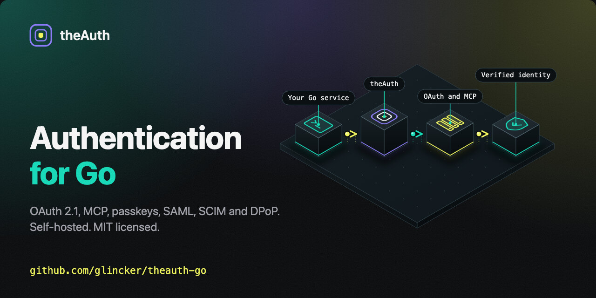

<p align="center">
  <a href="https://theauth.dev">
    
  </a>
</p>

<h1 align="center">theauth-go</h1>

<p align="center"><strong>Go authentication library: OAuth 2.1 authorization server, MCP authorization, passkeys, SAML, SCIM and DPoP.</strong><br>
Mount it into your own <code>net/http</code>, chi, Gin, Echo or Fiber server. Your data stays in your own database (memory, SQLite, Postgres or MySQL). Self-hosted, MIT licensed, no hosted service.</p>

<p align="center">
  <a href="https://pkg.go.dev/github.com/glincker/theauth-go/v2"></a>
  <a href="https://github.com/glincker/theauth-go/blob/main/go.mod"></a>
  <a href="https://github.com/glincker/theauth-go/releases"></a>
  <a href="https://github.com/glincker/theauth-go/actions/workflows/ci.yml"></a>
  <a href="https://github.com/glincker/theauth-go/actions/workflows/codeql.yml"></a>
  <a href="https://goreportcard.com/report/github.com/glincker/theauth-go/v2"></a>
  <a href="https://codecov.io/gh/glincker/theauth-go"></a>
  <a href="https://scorecard.dev/viewer/?uri=github.com/glincker/theauth-go"></a>
  <a href="https://github.com/glincker/theauth-go/releases"></a>
  <a href="LICENSE"></a>
  <a href="https://discord.gg/Ar5pcaZB99"></a>
  <a href="https://context7.com/glincker/theauth-go"></a>
</p>

<p align="center">
  <a href="https://theauth.dev"><strong>Website</strong></a> &middot;
  <a href="https://docs.theauth.dev/go/getting-started/quick-start"><strong>Quickstart</strong></a> &middot;
  <a href="https://docs.theauth.dev/go"><strong>Docs</strong></a> &middot;
  <a href="https://pkg.go.dev/github.com/glincker/theauth-go/v2"><strong>pkg.go.dev</strong></a> &middot;
  <a href="./examples"><strong>Examples</strong></a> &middot;
  <a href="https://github.com/glincker/theauth-go/discussions"><strong>Discussions</strong></a> &middot;
  <a href="https://discord.gg/Ar5pcaZB99"><strong>Discord</strong></a>
</p>

<p align="center">
  <a href="https://theauth.dev">
    
  </a>
</p>

---

## What it is

theauth-go is the Go library for [theAuth](https://theauth.dev). It handles sign-in for people (passwords, magic links, social login, passkeys, TOTP, SAML SSO, SCIM provisioning) and for software (an OAuth 2.1 authorization server with PKCE, DPoP, device login, token exchange and agent identities, plus a resource server module for MCP).

It runs inside your process as an `http.Handler`. You keep your users, sessions and tokens in your own database. The root module is Go 1.25, MIT licensed, and every release is signed and ships an SBOM. The TypeScript library is [glincker/theauth](https://github.com/glincker/theauth).

**Verify it yourself.** This project is about four months old, so we point to things you can check instead of asking for trust: signed releases, test counts you can reproduce with `find`, and the exact benchmark statements we stand behind. See [docs/PROOF.md](./docs/PROOF.md).

## Contents

- [Install](#install)
- [Packages](#packages)
- [Quick start: net/http and SQLite](#quick-start-nethttp-and-sqlite)
- [Quick start: agent identity and delegation](#quick-start-agent-identity-and-delegation)
- [What you can build](#what-you-can-build)
- [Features](#features)
- [How it compares](#how-it-compares)
- [Storage backends](#storage-backends)
- [Stability](#stability)
- [Security](#security)
- [Migrating](#migrating)
- [FAQ](#faq)
- [Examples](#examples)

## Install

```bash
go get github.com/glincker/theauth-go/v2
go get github.com/glincker/theauth-go/storage/sqlite   # optional, embedded SQLite backend
```

The module path ends in `/v2`. The first resolvable v2 tag is `v2.6.0`, and the old path without `/v2` is frozen at `v1.0.0`. See [Migrating to /v2](https://docs.theauth.dev/go/migrations/to-v2-module-path).

### Verify releases

Release assets are signed keyless with cosign through GitHub Actions OIDC. Download `checksums.txt`, `checksums.txt.sig` and `checksums.txt.cert` from the release, then verify (replace `v2.8.0` with your tag):

```bash
cosign verify-blob \
  --certificate-identity "https://github.com/glincker/theauth-go/.github/workflows/release.yml@refs/tags/v2.8.0" \
  --certificate-oidc-issuer "https://token.actions.githubusercontent.com" \
  --signature checksums.txt.sig --certificate checksums.txt.cert checksums.txt
sha256sum --ignore-missing -c checksums.txt
```

Each `theauth-go-v*.tar.gz` and its `.sbom.json` also ship with `.sig` and `.cert` files that verify the same way.

## Packages

One Go module at the root plus three nested modules (`mcpresource`, `storage/sqlite`, `audit/sinks/otlp`) that carry their own dependencies. Everything else is a package inside the root module. Full index on [pkg.go.dev](https://pkg.go.dev/github.com/glincker/theauth-go/v2).

| Group | Packages |
|---|---|
| Core | `theauth-go/v2` (server, sessions, OAuth 2.1 authorization server, agent identity, MCP authorization), `admin`, `crypto`, `email`, [`policy`](https://docs.theauth.dev/go/guides/policy-engine), [`clientauth`](https://docs.theauth.dev/go/guides/cli-login) (device login for Go CLIs), [`otp`](./docs/otp.md), `openapi`, [`mcpresource`](https://docs.theauth.dev/go/concepts/resource-server) (separate module) |
| Storage | `storage`, `storage/memory`, `storage/postgres`, `storage/mysql`, `storage/sqlite` (separate module), [`storagetest`](https://docs.theauth.dev/go/guides/custom-storage-backend) |
| Audit sinks | `audit/sinks/splunkhec`, `audit/sinks/webhook`, `audit/sinks/otlp` (separate module) |
| Gin adapter | [`adapters/gin`](./adapters/gin) (separate module): native `Authn`, `RequireAuth`, `RequireAbility`, accessors and `Mount` |
| Echo adapter | [`adapters/echo`](./adapters/echo) (separate module): the same set for Echo v4 |
| Fiber adapter | [`adapters/fiber`](./adapters/fiber) (separate module): the same set for Fiber v2 through its net/http adaptor (responses are buffered) |
| Providers | `provider/` apple, bitbucket, discord, facebook, github, gitlab, google, linkedin, microsoft, slack, twitch, x, oidc, and [`generic`](./docs/provider-catalog.md) for 16 more (Spotify, Dropbox, Zoom, Kakao, Naver, Patreon, Box, Salesforce, Figma, Codeberg, Linear, PayPal, Kick, Hugging Face, Vercel, Yandex) |
| Commands | [`theauth-go`](./docs/cli.md) (secrets, OpenAPI), [`theauth-doctor`](https://docs.theauth.dev/go/guides/security-doctor) (security doctor), [`theauth-migrate`](https://docs.theauth.dev/go/migrations/migration-guide) (Auth0 and Cognito import) |

### Modules on pkg.go.dev

| Module | Go | Reference |
|---|---|---|
| `github.com/glincker/theauth-go/v2` | 1.25 | [pkg.go.dev](https://pkg.go.dev/github.com/glincker/theauth-go/v2) |
| `github.com/glincker/theauth-go/mcpresource` | 1.25 | [pkg.go.dev](https://pkg.go.dev/github.com/glincker/theauth-go/mcpresource) |
| `github.com/glincker/theauth-go/storage/sqlite` | 1.26 | [pkg.go.dev](https://pkg.go.dev/github.com/glincker/theauth-go/storage/sqlite) |
| `github.com/glincker/theauth-go/adapters/gin` | 1.26 | [pkg.go.dev](https://pkg.go.dev/github.com/glincker/theauth-go/adapters/gin) |
| `github.com/glincker/theauth-go/adapters/echo` | 1.26 | [pkg.go.dev](https://pkg.go.dev/github.com/glincker/theauth-go/adapters/echo) |
| `github.com/glincker/theauth-go/adapters/fiber` | 1.26 | [pkg.go.dev](https://pkg.go.dev/github.com/glincker/theauth-go/adapters/fiber) |

The TypeScript packages are listed in the [theAuth README](https://github.com/glincker/theauth#packages).

## Quick start: net/http and SQLite

A complete server with sign-up, sign-in, magic links, sessions and one protected route, stored in a single SQLite file. Errors are checked; paste it into a `main` package. The `storage/sqlite` module needs Go 1.26.

```go
package main

import (
	"context"
	"database/sql"
	"log"
	"net/http"

	"github.com/glincker/theauth-go/v2"
	sqlitestore "github.com/glincker/theauth-go/storage/sqlite"
	_ "modernc.org/sqlite"
)

func main() {
	ctx := context.Background()
	db, err := sql.Open("sqlite", "file:app.db?_pragma=foreign_keys(1)&_pragma=busy_timeout(5000)&_pragma=journal_mode(WAL)&_txlock=immediate")
	if err != nil {
		log.Fatal(err)
	}
	if err := sqlitestore.Migrate(ctx, db); err != nil {
		log.Fatal(err)
	}
	store, err := sqlitestore.New(db)
	if err != nil {
		log.Fatal(err)
	}

	a, err := theauth.New(theauth.Config{CoreStorage: store, BaseURL: "http://localhost:8080"})
	if err != nil {
		log.Fatal(err)
	}
	defer a.Close()

	mux := http.NewServeMux()
	mux.Handle("/auth/", a.Handler()) // sign-up, sign-in, magic link, sessions
	mux.Handle("GET /me", a.RequireAuth()(http.HandlerFunc(func(w http.ResponseWriter, r *http.Request) {
		user, _ := theauth.UserFromContext(r.Context())
		w.Write([]byte("hello " + user.Email))
	})))
	log.Fatal(http.ListenAndServe(":8080", mux))
}
```

For Postgres, chi or a runnable CLI with API tokens and device login, see [`examples/single-binary-sqlite`](./examples/single-binary-sqlite) and the [Quick Start](https://docs.theauth.dev/go/getting-started/quick-start).

Mounting: `a.Handler()` returns a plain `http.Handler` for `net/http`'s `ServeMux` and keeps the routes at their configured paths (`/auth/...`, `/oauth/...`), so no `http.StripPrefix` is needed. With chi, call `a.Mount(r)` on your router instead. Both register the same routes.

## Quick start: agent identity and delegation

Give an agent its own credential, then let it act for a user with a narrower scope. This needs `Config.AuthorizationServer` (which requires a 32 byte `EncryptionKey`) and `Config.AgentIdentity`, on a storage backend with agent identity support (memory, SQLite, Postgres or MySQL). `RegisterAgent` creates the agent and, because `Resource` is set, a delegation grant from the user to the agent in one call.

```go
package main

import (
	"context"
	"log"

	"github.com/glincker/theauth-go/v2"
	"github.com/glincker/theauth-go/v2/storage/memory"
)

func main() {
	ctx := context.Background()
	a, err := theauth.New(theauth.Config{
		Storage:       memory.New(),
		BaseURL:       "https://as.example.com",
		EncryptionKey: []byte("0123456789abcdef0123456789abcdef"), // 32 bytes, load from your secrets manager
		AuthorizationServer: &theauth.AuthorizationServerConfig{
			Issuer: "https://as.example.com",
			Resources: []theauth.ProtectedResource{
				{Identifier: "https://api.example.com", Scopes: []string{"read", "write"}},
			},
		},
		AgentIdentity: &theauth.AgentConfig{},
	})
	if err != nil {
		log.Fatal(err)
	}
	defer a.Close()

	// The human who owns the agent. In a real app this is a signed-in user.
	user, err := a.UserByID(ctx, ownerID)
	if err != nil {
		log.Fatal(err)
	}

	// 1. Create the agent and a delegation grant for "read" on one resource.
	reg, err := a.RegisterAgent(ctx, theauth.RegisterAgentInput{
		OwnerID:  user.ID,
		Name:     "report-bot",
		Scope:    []string{"read"},
		Resource: "https://api.example.com",
	})
	if err != nil {
		log.Fatal(err)
	}
	// reg.Secret.ClientID and reg.Secret.Secret are the agent's credential.
	// The secret is shown once and only its Argon2id hash is stored.

	// 2. The agent authenticates as itself (client credentials).
	self, err := a.ClientCredentialsToken(ctx, theauth.TokenRequest{
		GrantType:    "client_credentials",
		ClientID:     reg.Secret.ClientID,
		ClientSecret: reg.Secret.Secret,
		Resource:     "https://api.example.com",
		Scope:        []string{"read"},
	})
	if err != nil {
		log.Fatal(err)
	}
	_ = self.AccessToken // sub is "agent:<id>"

	// 3. The agent trades a user's access token for a delegated one
	// (RFC 8693). The result carries the user as sub and the agent in act.
	delegated, err := a.ExchangeToken(ctx, theauth.TokenExchangeRequest{
		ClientID:         reg.Secret.ClientID,
		ClientSecret:     reg.Secret.Secret,
		SubjectToken:     userAccessToken, // issued to the user by this authorization server
		SubjectTokenType: "urn:ietf:params:oauth:token-type:access_token",
		Resource:         "https://api.example.com",
		Scope:            []string{"read"},
	})
	if err != nil {
		log.Fatal(err)
	}
	log.Println("delegated token expires in", delegated.ExpiresIn, "seconds")
}
```

`ownerID` and `userAccessToken` stand in for values from your sign-in flow (the user's ULID and an access token the authorization server issued to that user). Revoke access at any point with `RevokeDelegation`, `SuspendAgent` or `RevokeAgent`; resource servers see the change on their next introspection. Details: [Agent identity and revocation](https://docs.theauth.dev/go/concepts/agent-identity), [Agent delegation](https://docs.theauth.dev/go/guides/agent-delegation) and [Authorization server](https://docs.theauth.dev/go/concepts/authorization-server).

## What you can build

### Add sign-in to a Go web app

Email and password, magic links, 12 OAuth login providers, generic OIDC and 16 more catalog providers, with server-side sessions. Start with the [net/http quick start](#quick-start-nethttp-and-sqlite) or the [Gin](./adapters/gin), [Echo](./adapters/echo) and [Fiber](./adapters/fiber) adapters. Guide: [Add an OAuth provider](https://docs.theauth.dev/go/guides/add-oauth-provider).

### Run an OAuth 2.1 authorization server in Go

Authorization code with PKCE, refresh rotation, `client_credentials`, token exchange, PAR, JAR, CIBA and DPoP, with dynamic client registration and client ID metadata documents. Guide: [Authorization server](https://docs.theauth.dev/go/concepts/authorization-server).

### Secure an MCP server

Use theauth-go as the authorization server for MCP clients, and the separate `mcpresource` module to validate tokens and guard tools in your MCP resource server. Example: [`examples/mcp-server`](./examples/mcp-server). Guides: [MCP authorization](https://docs.theauth.dev/go/concepts/mcp-authorization), [Protect MCP tools](https://docs.theauth.dev/go/guides/protect-mcp-tools).

### Passkeys and WebAuthn

Discoverable passkey login and TOTP with recovery codes, plus step-up checks with `RequireRecentAuth`. Example: [`examples/webauthn-passkey`](./examples/webauthn-passkey). Guide: [Enable passkeys](https://docs.theauth.dev/go/guides/webauthn-passkeys).

### Device login for Go CLIs

RFC 8628 device authorization on the server and the `clientauth` package in your CLI. Example: [`examples/cli-login`](./examples/cli-login). Guide: [CLI login](https://docs.theauth.dev/go/guides/cli-login).

### SAML SSO and SCIM provisioning

SAML 2.0 single sign-on, SCIM 2.0 user provisioning, organizations, RBAC and an append-only audit log with Splunk, webhook and OTLP sinks. Needs memory, SQLite, Postgres or MySQL storage. Guide: [Splunk audit streaming](https://docs.theauth.dev/go/guides/audit-log-splunk).

### Create a user for an existing identity

`CreateUser` adds a user row without sending email or creating a credential or session. It is idempotent on the normalized email, so calling it on every login of an external identity provider is safe, even concurrently. Typed errors match `ErrUserInvalidInput`, `ErrUserEmailConflict` and `ErrUserIDConflict` with `errors.Is`. Details: [docs/create-user.md](docs/create-user.md).

```go
u, err := a.CreateUser(ctx, theauth.CreateUserInput{Email: "ada@example.com", Name: "Ada"})
```

### Agent identity and delegation

Give an AI agent its own credential and let it act for a user with a narrower scope. See the [agent quick start](#quick-start-agent-identity-and-delegation).

## Features

| Area | What you get | Docs |
|---|---|---|
| Sign-in | Email and password (Argon2id, 12 character minimum), magic links, 12 OAuth login providers, generic OIDC | [Add an OAuth provider](https://docs.theauth.dev/go/guides/add-oauth-provider) |
| Second factors | WebAuthn passkeys with discoverable login, TOTP with recovery codes, step-up with `RequireRecentAuth` | [Enable passkeys](https://docs.theauth.dev/go/guides/webauthn-passkeys) |
| Sessions | Opaque server-side sessions, session list and revoke, idle timeout | [Configuration](https://docs.theauth.dev/go/reference/configuration) |
| API tokens and CLIs | Scoped tokens with `RequireAbility`, RFC 8628 device login via the `clientauth` package | [API tokens](https://docs.theauth.dev/go/guides/api-tokens), [CLI login](https://docs.theauth.dev/go/guides/cli-login) |
| OAuth 2.1 server | Authorization code with PKCE, refresh rotation, `client_credentials`, token exchange, CIBA, PAR, JAR, DPoP | [OAuth 2.1 primer](https://docs.theauth.dev/go/concepts/oauth21-primer), [Authorization server](https://docs.theauth.dev/go/concepts/authorization-server) |
| Token policy, RAR and ID-JAG | Per-client signing algorithm (EdDSA, ES256, RS256) and opaque access tokens, RFC 9396 `authorization_details` end to end, and ID-JAG issue and redeem over token exchange and jwt-bearer | [Token policy](./docs/access-token-policy.md), [RAR](./docs/rich-authorization-requests.md), [ID-JAG](./docs/id-jag.md) |
| OpenID Provider | ID tokens with nonce and `at_hash`, userinfo, RP-initiated and back-channel logout, pairwise subjects, OpenID discovery fields | [OpenID Provider](./docs/oidc-provider.md) |
| Multi-replica and abuse controls | Pluggable rate limiter, DPoP replay cache and CIMD cache (memory, SQL, Redis or your own), per-IP and per-client limits and an Argon2id concurrency cap on the OAuth endpoints | [Pluggable stores](./docs/pluggable-stores.md), [Endpoint limits](./docs/oauth-endpoint-limits.md), [Request admission](./docs/admission.md) |
| Browserless OAuth | RFC 8628 device authorization grant on the authorization server with a themable verification page, plus scoped one-time registration tokens for agents | [Device grant](./docs/device-authorization.md), [Registration tokens](./docs/registration-tokens.md) |
| One-time codes | Email and SMS OTP with pluggable senders (Twilio built in), resend cooldown, attempt limit, lockout, constant-time compare | [OTP](./docs/otp.md) |
| More sign-in providers | Table-driven catalog of 16 more OAuth providers, custom specs, and OIDC discovery overrides | [Provider catalog](./docs/provider-catalog.md) |
| Developer CLI and OpenAPI | `theauth-go secret` and `theauth-go openapi`, plus `openapi.Generate` for your own router | [CLI](./docs/cli.md) |
| MCP and agents | MCP authorization (protected resource metadata, CIMD), agent identities with delegation, `mcpresource` SDK module (scope and step-up guards, tool security metadata) | [MCP authorization](https://docs.theauth.dev/go/concepts/mcp-authorization), [Resource server](https://docs.theauth.dev/go/concepts/resource-server), [Protect MCP tools](https://docs.theauth.dev/go/guides/protect-mcp-tools) |
| Enterprise | SAML 2.0 SSO, SCIM 2.0, organizations, RBAC, append-only audit log with SIEM sinks | [Splunk audit streaming](https://docs.theauth.dev/go/guides/audit-log-splunk), [Threat model](https://docs.theauth.dev/go/security/threat-model) |
| Policy | Authorization policy engine | [Policy engine](https://docs.theauth.dev/go/guides/policy-engine) |
| Observability | OpenTelemetry spans, Prometheus metrics | [OpenTelemetry tracing](https://docs.theauth.dev/go/guides/opentelemetry-tracing), [Metrics](https://docs.theauth.dev/go/reference/metrics) |
| Supply chain | SBOM and Sigstore signed release artifacts, SLSA 3 provenance | [Releases and verification](https://docs.theauth.dev/go/security/releases) |

## Running more than one replica

Rate limits, DPoP replay records and the CIMD cache are per process by default. Share them through the database you already have:

```go
db := stdlib.OpenDBFromPool(pool) // pgx stdlib
kvStore, _ := sqlkv.New(db, sqlkv.Postgres)
_ = kvStore.EnsureSchema(ctx)

auth, _ := theauth.New(theauth.Config{
    // ...
    Stores: kv.FromCache(kvStore), // or kv/redis, or your own kv.RateLimiter / kv.ReplayCache / kv.Cache
})
```

Details and the Redis adapter are in [docs/pluggable-stores.md](./docs/pluggable-stores.md).

## Choosing between a library and a hosted service

theauth-go is a library you embed and run yourself, so you own the database and the operations. It does not include a hosted login UI or a managed service. If you need either, it is not the right shape for you. The TypeScript library at [glincker/theauth](https://github.com/glincker/theauth) covers Node, Bun, Deno and Workers backends.

## How it compares

Public GitHub stats for Go auth projects, pulled from the GitHub API on 2026-10-30. This is a size and age snapshot, not a feature comparison. Check each project's own docs for what it supports.

| Project | Stars | Created | Last push | License | Shape |
|---|---|---|---|---|---|
| glincker/theauth-go | 6 | 2026-06 | 2026-10 | MIT | Sign-in, OAuth 2.1 server and MCP authorization in one library |
| [ory/fosite](https://github.com/ory/fosite) | 2,631 | 2015-12 | 2025-11-20 | Apache-2.0 | OAuth2/OIDC server SDK, no user management |
| [go-oauth2/oauth2](https://github.com/go-oauth2/oauth2) | 3,627 | 2016-05 | 2026-09-01 | MIT | OAuth2 server library |
| [aarondl/authboss](https://github.com/aarondl/authboss) | 4,201 | 2015-01 | 2026-07-10 | MIT | Modular web auth (sign-in, confirm, recover) |
| [go-pkgz/auth](https://github.com/go-pkgz/auth) | 1,355 | 2018-12 | 2026-10-28 | MIT | Social, email and Telegram login middleware |
| [markbates/goth](https://github.com/markbates/goth) | 6,620 | 2014-10 | 2026-02-11 | MIT | Social login (client side) |
| [go-webauthn/webauthn](https://github.com/go-webauthn/webauthn) | 1,357 | 2021-12 | 2026-10-29 | BSD-3 | WebAuthn and passkeys only |
| [coreos/go-oidc](https://github.com/coreos/go-oidc) | 2,503 | 2015-06 | 2026-10-19 | Apache-2.0 | OIDC client and verifier |
| [golang/oauth2](https://github.com/golang/oauth2) | 5,908 | 2014-04 | 2026-09-08 | BSD-3 | OAuth2 client |

Standalone servers such as ory/hydra, zitadel, casdoor, authelia, dex and pocket-id are a different shape: you run them as a separate service. They have far more stars and history than this library.

When to pick which. If you want a separate identity service with its own admin UI, a standalone server is the safer, better established choice. If you want auth inside your own Go process and database, an embeddable library fits, and you can pick a narrow one (fosite for the OAuth2 server, goth or go-oidc for client side login, go-webauthn for passkeys) or a broader one like this. If you only call other providers' APIs, a client helper such as golang/oauth2 is enough. theauth-go's age is its main weakness; [docs/PROOF.md](./docs/PROOF.md) lists what you can verify and what is still experimental.

## Storage backends

Persistence is split into small capability interfaces, and `New` fails at startup if a feature you enabled has no matching capability. Full matrix: [Capability interfaces](https://docs.theauth.dev/go/concepts/capability-interfaces).

| Capability | memory | sqlite | postgres | mysql |
|---|---|---|---|---|
| Users, sessions, magic links, passwords | Yes | Yes | Yes | Yes |
| OAuth accounts, passkeys, TOTP, audit log | Yes | Yes | Yes | Yes |
| Scoped API tokens, device grant, session management | Yes | Yes | Yes | Yes |
| Organizations, SAML, SCIM, RBAC | Yes | Yes | Yes | Yes |
| OAuth 2.1 authorization server, agent identity | Yes | Yes | Yes | Yes |
| CIBA backchannel auth | Yes | Yes | Yes | No |
| OAuth device grant (RFC 8628) and registration tokens | Yes | Yes | Yes | Yes |
| Durable JWT-bearer `jti` replay | Yes | Yes | No | No |

Postgres and MySQL implement the newer token, device, session and throttle capabilities and pass the new `storagetest` suites against live PostgreSQL 16 and MySQL 8. The full shared contract passes on Postgres when you opt in with `THEAUTH_PG_CONTRACT=1` and a DSN in `THEAUTH_TEST_PG_DSN` (verified on PostgreSQL 14), but that gate is not enabled in CI yet. The MySQL gate is still off, so treat MySQL support for the newer features as newly added. You can write your own backend and verify it with the public [`storagetest`](./storagetest) suite.

## Stability

Packages and APIs that were Stable before v2.6 keep their SemVer guarantees. Among the additions in v2.6, only the storage capability split, `Handler()` and `Config.PathPrefix` are Stable. Experimental: `storage/sqlite`, `clientauth`, `policy`, the agent identity and revocation APIs, `Doctor`, `Config.ProviderResolver` and the new optional storage capabilities. Experimental APIs may change in a minor release. The SemVer rules and the list of stable packages are in [STABILITY.md](https://docs.theauth.dev/go/reference/stability).

## Security

- Passwords are hashed with Argon2id, sessions are opaque and stored server side, and agent secrets are shown once and stored only as hashes.
- Release assets are signed with cosign, ship an SBOM and carry SLSA 3 provenance. See [Verify releases](#verify-releases).
- CI runs CodeQL, `govulncheck`, dependency review and OpenSSF Scorecard.
- The [threat model](https://docs.theauth.dev/go/security/threat-model) and the `theauth-doctor` [security doctor](https://docs.theauth.dev/go/guides/security-doctor) describe what is covered and how to check a deployment.
- Report vulnerabilities privately through [GitHub advisories](https://github.com/glincker/theauth-go/security/advisories/new) or support@glinr.com, as described in the [security policy](.github/SECURITY.md). Do not open a public issue.

## Migrating

- From Auth0: [Migrate from Auth0](https://docs.theauth.dev/go/guides/migrate-from-auth0)
- From Cognito: [Migrate from Cognito](https://docs.theauth.dev/go/guides/migrate-from-cognito)
- From Keycloak: [Migrate from Keycloak](./docs/MIGRATING-FROM-KEYCLOAK.md)
- From hand-rolled sessions: [Migrate from hand-rolled sessions](https://docs.theauth.dev/go/guides/migrate-from-hand-rolled-sessions)
- From the v1 module path: [Migrating to /v2](https://docs.theauth.dev/go/migrations/to-v2-module-path)

## FAQ

**Does theauth-go work without Postgres?**
Yes. Use `storage/sqlite` for a single static binary with one database file, `storage/memory` for tests, or MySQL. SQLite supports organizations, SAML, SCIM and RBAC, and runs the OAuth 2.1 authorization server, agents and CIBA (migrations 0020 to 0034); see docs/storage-capabilities.md.

**How do I add passkeys to a Go app?**
Set `Config.WebAuthn` and use a storage backend that implements `WebAuthnStorage` (all four built in backends do). Register and login routes are then mounted under your auth handler. See the [passkeys guide](https://docs.theauth.dev/go/guides/webauthn-passkeys) and [`examples/webauthn-passkey`](./examples/webauthn-passkey).

**Does it support MCP authorization?**
Yes. The library can act as the OAuth 2.1 authorization server and publishes protected resource metadata. The separate zero dependency `mcpresource` module validates tokens inside an MCP resource server. See [MCP authorization](https://docs.theauth.dev/go/concepts/mcp-authorization) and [`examples/mcp-server`](./examples/mcp-server).

**How do I migrate from Auth0, Cognito or Keycloak?**
Follow [Migrate from Auth0](https://docs.theauth.dev/go/guides/migrate-from-auth0), [Migrate from Cognito](https://docs.theauth.dev/go/guides/migrate-from-cognito) or [Migrate from Keycloak](https://github.com/glincker/theauth-go/blob/main/docs/MIGRATING-FROM-KEYCLOAK.md). Password hashes carry over and upgrade to Argon2id at each user's first login. Coming from hand-rolled sessions: [Migrate from hand-rolled sessions](https://docs.theauth.dev/go/guides/migrate-from-hand-rolled-sessions).

**Which Go versions are supported?**
The root module declares Go 1.25. `storage/sqlite` is a separate module and needs Go 1.26.

**Is it a hosted service?**
No. It is a library you run inside your own process, under the MIT license.

## Examples

Runnable apps live in [`examples/`](./examples), each with its own `go.mod` and a short README. More in the [example apps guide](https://docs.theauth.dev/go/getting-started/example-apps).

| Area | Examples |
|---|---|
| Frameworks | [`single-binary-sqlite`](./examples/single-binary-sqlite), [`chi-app`](./examples/chi-app), [`gin-app`](./examples/gin-app), [`echo-app`](./examples/echo-app), [`stdlib-app`](./examples/stdlib-app) |
| OAuth providers | [`oauth-multi-provider`](./examples/oauth-multi-provider), [`oauth-apple`](./examples/oauth-apple), [`oauth-bitbucket`](./examples/oauth-bitbucket), [`oauth-facebook`](./examples/oauth-facebook), [`oauth-gitlab`](./examples/oauth-gitlab), [`oauth-linkedin`](./examples/oauth-linkedin), [`oauth-slack`](./examples/oauth-slack), [`oauth-twitch`](./examples/oauth-twitch), [`oauth-x`](./examples/oauth-x) |
| Second factors | [`webauthn-passkey`](./examples/webauthn-passkey), [`totp-stepup`](./examples/totp-stepup) |
| Agents and CLIs | [`mcp-server`](./examples/mcp-server), [`cli-login`](./examples/cli-login) |
| Operations | [`doctor-admin`](./examples/doctor-admin), [`observability-otel`](./examples/observability-otel), [`observability-prom`](./examples/observability-prom) |

## Links

- [Documentation](https://docs.theauth.dev/go) and [API reference on pkg.go.dev](https://pkg.go.dev/github.com/glincker/theauth-go/v2)
- [CHANGELOG](CHANGELOG.md), [STABILITY](https://docs.theauth.dev/go/reference/stability), [ROADMAP](docs/ROADMAP.md)
- [Security policy](.github/SECURITY.md): report vulnerabilities privately to support@glinr.com or through GitHub advisories, not in public issues
- [Contributing](.github/CONTRIBUTING.md), [Discussions](https://github.com/glincker/theauth-go/discussions), [GLINR Discord](https://discord.gg/Ar5pcaZB99)
- [AGENTS.md](docs/AGENTS.md) and [llms.txt](llms.txt) for AI coding assistants
- [License: MIT](LICENSE)

## Made by GLINCKER, a GLINR STUDIOS company

theAuth is built and maintained in the open by [GLINCKER](https://glincker.com), the open-source division of [GLINR STUDIOS](https://glinr.com). Founder: [thegdsks.com](https://thegdsks.com). The TypeScript library is [glincker/theauth](https://github.com/glincker/theauth).

| Partner project | What it is | Site | Source |
|---|---|---|---|
| **LevelRail** | Self-hosted deployment platform: push to git, get a running app. | [levelrail.com](https://levelrail.com) | [glincker/levelrail](https://github.com/glincker/levelrail) |
| **theSVG** | Open-source brand SVG icons. | [thesvg.org](https://thesvg.org) | [glincker/thesvg](https://github.com/glincker/thesvg) |
| **GLINUI** | Open-source liquid glass UI components for React. theauth.dev is designed with it. | [glinui.com](https://glinui.com) | [glincker/glinui](https://github.com/glincker/glinui) |
